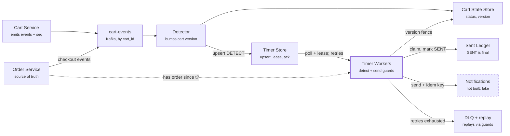

# Abandoned-cart detection and scheduling pipeline

Runnable reference implementation of the design described in this README. Java 17+, no runtime dependencies; builds and tests with only a JDK (Maven optional).
It detects abandoned carts and schedules reminders. It does **not** send anything: a fake provider
records what would be delivered, and a `FakeClock` drives time.

## Architecture

Abandonment is detected event-driven, from the cart event stream, with one durable timer per cart. Reminders are separate timers fenced by a cart version number, so any shopper action invalidates every pending reminder without deleting anything. A send happens only after four guards pass, and every send carries an idempotency key, so at-least-once infrastructure produces at most one reminder per slot.

The design rests on one rule: **every applied shopper event bumps `cart.version`, and a timer only acts if the cart is still at the version it was created for.** Edit-resets-the-clock, checkout, clear, resume and guest merge all fall out of that rule.



Shopper events flow left to right into cart state and one DETECT timer per cart. Everything that can send a message runs through the Timer Workers, which check the version fence, the Order Service, lateness and the ledger before the provider call.

| Component | Responsibility | Talks to | Production choice (assumed) |
| --- | --- | --- | --- |
| Cart Service | Owns carts; publishes add/edit/remove/clear/resume/merge events with a per-cart `seq` via a transactional outbox | Kafka `cart-events` | Existing service |
| Order Service | Publishes `CHECKOUT_COMPLETED`; answers "has this cart been ordered since t?" | Kafka `cart-events`; sync read API | Existing service |
| Abandonment Detector | Consumes `cart-events` keyed by `cart_id`; applies the event to cart state; re-arms the cart's DETECT timer | Cart State Store, Timer Store | Stateless consumer group, 64 partitions |
| Cart State Store | Status, version, last activity, items, arm, reminder count per cart | Detector, Timer Workers | DynamoDB (conditional writes) or Redis |
| Timer Store | Durable delay queue: upsert by id, lease on poll, compare-and-ack | Detector, Timer Workers | Redis sorted sets sharded by cart, replicated with AOF |
| Timer Workers | DETECT: mark abandoned, assign experiment arm, schedule reminders. REMINDER: run guards, call the notification service | Timer Store, State Store, Order Service, Ledger, Notification Service | Stateless pool |
| Sent Ledger | One row per reminder key; `SENT` is terminal | Timer Workers | DynamoDB with 30-day TTL |
| Notification Service | Consent, channel choice, rendering, provider call (out of scope: not implemented) | Email/push provider | Existing service |
| DLQ + replay tool | Holds reminders that failed permanently or exhausted retries; replays through all guards | Timer Store | SQS or Kafka DLQ topic |
| Outcome stream | Every decision (abandoned, sent, cancelled, blocked, expired) for metrics and experiments | Warehouse | Kafka `reminder-outcomes` |

In the runnable pipeline, Timer Workers and the dispatcher run as one process, and each store is an in-memory class that keeps the property the design relies on (see *Runnable pipeline and fake-clock verifier* below).

## Run

Requires JDK 17+. No Maven, Gradle or network needed.

```sh
./run.sh              # build, run the 27 scenario tests, then the walkthrough + 20k-cart soak
./run.sh test         # tests only
./run.sh demo         # walkthrough + soak only
```

On Windows, use `run.cmd` (same options).

With Maven:

```sh
mvn test              # the same 27 scenarios under JUnit 5
mvn compile exec:java # walkthrough + soak
```

## Layout

```
src/main/java/com/example/cartrecovery/
  Pipeline.java          wires the components and drives the fake clock
  engine/                the logic we own
    AbandonmentDetector    consumes events: dedup by seq, apply, bump version, upsert the DETECT timer
    TimerWorker            fires due timers: detection, send guards, ledger, send, retry, DLQ
    ExperimentAssigner     sticky hash of userId (cartId for guests) into holdout / arms
  store/                 in-memory stand-ins for durable stores
    CartStateStore         cart state, one conditional write per event      (DynamoDB / Redis)
    TimerStore             upsert by id, lease, compare-and-ack             (Redis sorted sets)
    SentLedger             one row per reminder slot; SENT is final         (DynamoDB)
    DeadLetterQueue        failed reminders, drained for replay             (SQS / Kafka DLQ)
  stream/
    EventBus               cart-events: arrival times model lag and redelivery   (Kafka)
    OutcomeLog             reminder-outcomes: every decision, for metrics and tests
  external/              fakes of existing systems
    CartService            builds events and stamps the per-cart seq
    OrderService           "has this cart been ordered since t?"
    NotificationProvider   records triggers that would be sent; idempotency key; fault injection
  model/                 records and enums: CartEvent, CartState, Timer, Trigger, Outcome, Arm, ...
  config/                Config: every tunable (window, offsets, retries, lateness, cap, arms)
  clock/                 Clock and FakeClock
  verify/
    Verifier               readable fake-clock walkthrough of 5 shoppers + soak (main class)
    Soak                   20k randomised carts with faults, checked against invariants
src/test/java/com/example/cartrecovery/
  *Scenarios             27 fake-clock scenarios, each written once (@Scenario):
                         Detection, Cancellation, Idempotency, FailureHandling, Secondary, Soak
  PipelineTests          runs every scenario with only a JDK (used by run.sh / run.cmd)
  PipelineJUnitTest      runs every scenario under JUnit 5 (used by mvn test)
```

## Rules the code implements

* Every applied shopper event bumps `cart.version`. Timers carry the version they were created for; a timer whose version no longer matches does nothing. That one rule covers edit-resets-clock, checkout, clear, resume and merge, with no timer deletion.
* Events carry a per-cart `seq` stamped by the cart service. Duplicates and late, older events are ignored.
* Inactivity is measured from event time, not processing time, so consumer lag never stretches the window.
* At equal timestamps, events are processed before timers (a checkout at 00:30:00 beats a reminder due at 00:30:00).
* Before a send, in order: version fence → Order Service check → lateness (`maxLatenessS`) → reachable user → ledger already `SENT` → per-cart cap.
* Send = ledger claim (counted toward the cap) → provider call with idempotency key `cart:v{version}:r{idx}` → mark `SENT` → ack. A crash anywhere in between causes redelivery after the lease, and the provider drops the repeat.
* Transient failures retry with exponential backoff (30 s, 60 s, 120 s … capped at 15 min) up to 5 attempts, then DLQ. Permanent failures go straight to the DLQ. `replayDlq()` re-arms them through every guard again.

Times are `long` epoch seconds throughout, so fake-clock assertions are exact.

---
